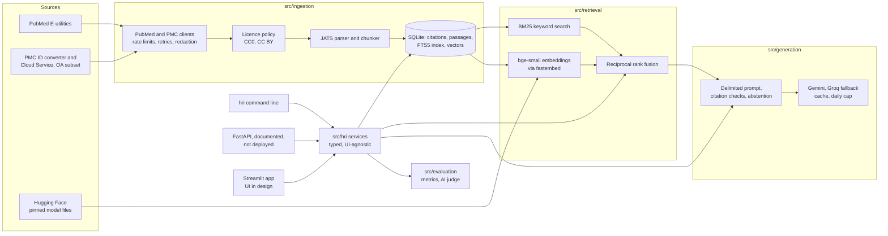

# Healthcare Research Intelligence

A research aid that searches biomedical literature and answers questions
**only from openly licensed full text it has stored, citing every claim**,
and saying "insufficient evidence" instead of guessing. Built in Python with
a standard-library core, a tested service layer, and an evaluation harness
that reports its own weaknesses.

> Research aid only, not medical advice. Not clinically validated.

## The problem

Biomedical literature grows faster than anyone can read it. General chatbots
answer fluently but can invent studies, misquote findings, and use text they
have no right to. This project explores the opposite trade-off: a narrow,
checkable assistant that

- only uses sources it is allowed to store (PubMed citations; CC0 and CC BY
  open-access full text from PubMed Central),
- retrieves the exact passages behind an answer,
- verifies every citation against what was retrieved,
- declines when the evidence is missing, off-topic, or contradictory,
- and measures all of this on a question set, including its failures.

## Architecture



Every interface (command line, REST API, Streamlit app) calls only the
service layer, `hri.services`; its contract is
[docs/SERVICE_API.md](docs/SERVICE_API.md).

## Features

**Implemented and tested**

- **PubMed citation search and storage:** title, title/abstract, author,
  DOI and PMID modes; year filters; paging; shared rate limiting, bounded
  retries, and error messages that never contain keys or URLs. Duplicates are
  matched only by PMID or DOI. PubMed abstracts are never stored.
- **Local citation search:** keyword, fuzzy-title and Boolean
  (`AND`/`OR`/`NOT`, parentheses, phrases), with year and abstract filters.
- **Saved lists** with CSV, Vancouver (NLM) and plain-text export.
- **Licensed open-access full text** from PubMed Central: current version
  only, licence checked before download, retracted articles rejected (PMC
  status and PubMed `RetractionIn` links), corrections and expressions of
  concern flagged, attribution stored with every article.
- **Passage search:** SQLite FTS5 with BM25, and meaning-based search with a
  pinned, checksum-verified embedding model; fused by reciprocal rank fusion.
- **Answers with checked citations:** passages wrapped as untrusted data,
  invented citations removed, abstention before and after the model call,
  Gemini with Groq fallback, answer cache, daily request cap, and a "busy"
  answer instead of an error when providers refuse.
- **Evaluation harness:** recall@k, precision@k and MRR for three retrieval
  methods; evidence recall, citation validity, AI-judged claim support,
  correct abstention and response time; before/after comparisons; a
  human spot-check workflow.
- **Deployment preparation:** read-only data bundle with manifest and
  checksum, GitHub Actions for CI and weekly bundle builds, Streamlit
  Community Cloud settings and start-up self-check, FastAPI interface.

**Planned or not built**

- The user interface (being designed; see below).
- Comparing findings across papers beyond what one cited answer does.
- A vector index for large collections (search is brute force today).
- Sources other than PubMed and PMC.

## UI — in design

The interface is being designed separately. Until then `streamlit_app.py`
is a **placeholder page** that only proves the deployment works. Everything
the UI needs is in `hri.services`, including `SessionSavedLists` and
`VisitorQuota` for a read-only deployment ([docs/SERVICE_API.md](docs/SERVICE_API.md)).

## Setup

The core needs Python 3.9 or newer and **no third-party packages**.
Optional extras: `embeddings` (fastembed, Python 3.10+), `app` (Streamlit)
and `api` (FastAPI) (both Python 3.11+), `dev` (ruff, httpx).

```bash
git clone https://github.com/Ronitshah042/healthcare-research-intelligence.git
cd healthcare-research-intelligence
python3 -m venv .venv && source .venv/bin/activate
pip install -e .                                        # core: the hri command
pip install -e '.[embeddings]' -c constraints-embeddings.txt   # meaning-based search
pip install -r requirements.txt -r requirements-dev.txt        # app, API, lint, tests

PYTHONPATH=src python3 -m unittest discover -s tests    # no network needed
ruff check src tests streamlit_app.py
```

Live requests need settings: copy `.env.example` to `.env` (ignored by Git),
fill in your NCBI tool name and developer email (and optional AI keys), and
load it with `set -a; source .env; set +a`.

## Command line

```bash
hri ingest --query "type 2 diabetes" --mode title_abstract --max 200 --year-from 2018
hri search "metformin AND cardiovascular" --type boolean --year-from 2020
hri show 33301246
hri stats
hri lists create "To read"; hri lists add "To read" 33301246
hri lists export "To read" --format citations

hri fetch-fulltext --from-db --max 20        # CC0/CC BY open-access full text
hri recheck-fulltext                         # remove articles retracted since
hri embed-passages                           # download the model once, embed passages
hri search-passages "metformin dementia" --section results

hri ask "What does the evidence say about metformin and dementia?"

hri eval --set eval/questions.json --db data/eval.sqlite3
hri eval-verdicts eval/spotcheck-<date>.csv  # verdicts without article text
hri build-bundle --topics topics.json --output dist
```

`hri <command> --help` lists every option. The database is
`data/hri.sqlite3` unless `HRI_DB_PATH` or `--db` says otherwise.

## REST API

A FastAPI app in `src/api/` exposes `/health`, `/search`, `/papers/{id}`,
`/stats`, `/ask`, and token-protected `/ingest` and `/index`, with one error
format. It is the documented interface, not part of the deployment:
[docs/API.md](docs/API.md).

## Content and licence policy

Only the PubMed Central Open Access subset is stored, and only CC0 and CC BY
by default; other licences are rejected before any text is downloaded.
PubMed abstracts are never stored. Every stored article keeps its licence
and attribution, every answer and passage shows it, and PubMed results carry
NLM's attribution and disclaimer. Questions sent to Gemini's free tier may be
used by Google to improve its products, so the app says so with every answer.
Details: [docs/CONTENT_POLICY.md](docs/CONTENT_POLICY.md).

## Evaluation

Measured with `hri eval` on a reviewed set of 32 questions over 18 articles
(set 1). Full report and method: [docs/EVAL_RESULTS.md](docs/EVAL_RESULTS.md).

| Measure | Result |
| --- | --- |
| Hybrid retrieval recall@5 / MRR (article level) | 98% / 0.98 |
| Relevant articles reaching the model (evidence recall) | 93% |
| Citations naming a supplied passage | 100% (211) |
| Claims rated supported by an AI judge (Groq, a different model family) | 98%; 2% partial, 0% unsupported |
| Correct abstention / answered when expected | 100% (9) / 91% (21 of 23) |
| Response time, uncached | median 3.6 s |

Read these as a regression baseline, not real-world accuracy: the questions
were written by the developer from the stored text, the judge is an AI whose
agreement with a human is still pending, and two attempts to improve evidence
selection were rejected because they lowered claim support. A second,
held-out question set written from article body text is awaiting review.

## Deployment

Streamlit Community Cloud runs the app from a **read-only data bundle**
(14 MB: 174 citations, 96 CC BY articles, 2,392 passages) that a weekly GitHub Actions workflow builds and
publishes as a release asset; the app downloads it once, verifies its
SHA-256, and keeps all run-time state in memory. Step-by-step setup, secrets,
rebuilding, and free-tier limits: [docs/DEPLOYMENT.md](docs/DEPLOYMENT.md).

## Limitations

- **Small collection:** a bundle of about 100 open-access articles on
  cardiometabolic topics; most journals' text is not openly licensed.
- **Evaluation is small and developer-written;** treat numbers as a baseline.
- **Keyword search needs shared words;** meaning-based search helps but is a
  small model, and about 14% of passages exceed its 512-token input.
- **Answers depend on free AI tiers:** rate limits, quotas, and Gemini's
  free-tier data use. When providers refuse, the app says it is busy.
- **Correction and retraction flags are only as complete as PMC and PubMed's
  links;** a missing flag does not prove an article is uncorrected.
- **Deployed state is not persistent:** saved lists, cached answers and the
  daily count reset when the app restarts.

## Roadmap

1. The UI (in design), on top of the existing services.
2. Review and run the held-out question set; collect the human spot-check.
3. Evidence selection that adds a second article only when it is nearly as
   relevant, judged on the held-out set.
4. A vector index if the collection grows beyond tens of thousands of
   passages.

## Project documents

[SERVICE_API](docs/SERVICE_API.md) ·
[API](docs/API.md) ·
[CONTENT_POLICY](docs/CONTENT_POLICY.md) ·
[DEPLOYMENT](docs/DEPLOYMENT.md) ·
[EVAL_RESULTS](docs/EVAL_RESULTS.md) ·
[DECISIONS](docs/DECISIONS.md) ·
[PUBMED_INTEGRATION](docs/PUBMED_INTEGRATION.md) ·
[PROJECT_LOG](docs/PROJECT_LOG.md) ·
[LEARNING_NOTES](docs/LEARNING_NOTES.md)

PubMed data courtesy of the U.S. National Library of Medicine (NLM). This
independent project is not affiliated with, endorsed by, or sponsored by
NCBI, NLM, NIH, or HHS ([NCBI policies](https://www.ncbi.nlm.nih.gov/home/about/policies/)).
